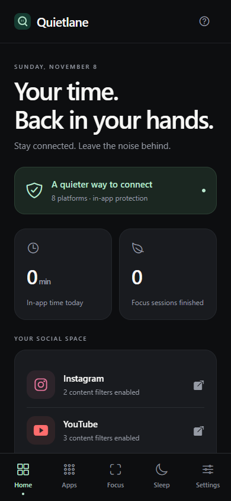
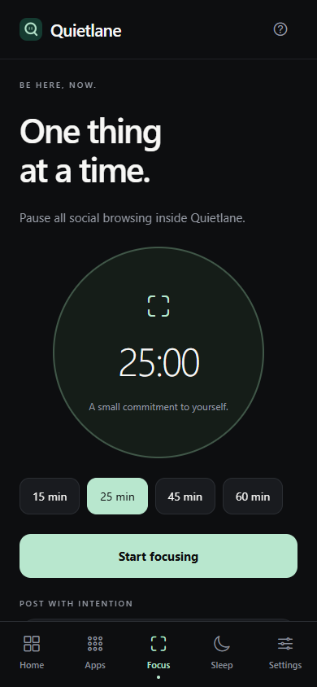

# Quietlane

An open-source, local-first iPhone and Android app for focused social browsing, focus sessions, and sleep routines. **No Quietlane account or login is required.** Social websites may require their own sign-in for private content.

 

*Web-rendered previews. Native social browsing requires an iPhone or Android device.*

## Run locally

Prerequisites: Node 22.18+ (Node 26 matches the CI template), npm, and an Expo Go version compatible with Expo SDK 58.

```sh
git clone https://github.com/darkaimzzz/quietlane.git
cd quietlane/mobile
npm ci
npx expo start --go
```

Scan the QR code in Expo Go on the same Wi-Fi as your computer. Browser preview: `npm run web`. On Windows, you can also use `Start-App.cmd` from the repository root.

## Features

- Account-free onboarding and local focus, sleep, and settings tools.
- Eight social website launchers with platform-specific filtering controls.
- Known short-form/discovery route guards, selected feed/ad containers, and YouTube recommendation filtering.
- Exact shared-clip access, timed Post Mode, optional messages-first launching, local usage budgets, and up to 90 days of in-app activity.
- Browser navigation, sharing, loading timeout/retry, Instagram sign-in recovery, acknowledged filter startup/retry, and external-link confirmation.
- Local preference/activity export and reset, bundled privacy information, and email support.
- Expo Router navigation, native/web controls, safe areas, and error fallbacks.

Protection applies **inside Quietlane only**. This project does not implement native-app shielding, device-wide parental controls, private-message push notifications, an account backend, or subscriptions. Live camera/microphone capture is disabled.

Third-party sign-in, DOM filtering, uploads, and playback depend on each platform's web experience and need native-device validation. This is a release candidate, not a signed or published store release.

Instagram rendering, its sign-in form, Reels/Explore/Home blocking, and continued message access were confirmed by the user on an iPhone. Other platforms, uploads, playback, and complete authenticated flows still need device testing.

## Development checks

Run inside `mobile/`:

```sh
npm run verify
npx expo-doctor
npm audit
npx expo export --platform all
```

If you change `blockedRoute` or `sharedFromMessages` in `engine.ts`, run `npm run generate:browser-guards` and commit the generated file. Tests reject stale guard source; device builds must not serialize functions with `.toString()`.

The optional [CI template](ci/github-actions.yml) runs type checks, lint, tests, SDK checks, dependency audit, and exports when installed in .github/workflows/. Enabling it requires GitHub workflow permission; it is not active by default. Native signing/device tests are separate.

## Project layout

| Path | Purpose |
| --- | --- |
| `mobile/src/app/` | Expo Router screens |
| `mobile/src/engine.ts` | Filtering, URL validation, schedules, usage calculations |
| `mobile/src/model.ts` | Local state, persistence, timer lifecycle |
| `mobile/src/browser.tsx` | Native protected browser |
| `mobile/tests/` | Regression and release checks |
| `mobile/public/` | Standalone privacy/support HTML |
| `release/` | Store copy, release checklist, preview screenshots |
| `docs/` | Audit and verification notes |

Generated native folders, dependency folders, caches, credentials, and local source archives are excluded from Git. EAS builds regenerate native projects from `app.json`.

Scoped dependency overrides patch known glob/minimatch advisories. Expo's current React lint plugin requires ESLint 9; its upstream deprecation is documented. Existing prototype preferences keep their original local storage key for compatibility.

## Contributing and support

See [CONTRIBUTING.md](CONTRIBUTING.md) and [SECURITY.md](SECURITY.md).
Release status and remaining native/store checks are in [release/CHECKLIST.md](release/CHECKLIST.md).

Support: nishaadbharaswadkar@gmail.com

## License

[MIT](LICENSE). Original Expo template notices are retained. Quietlane is independent of the social platforms it opens.
